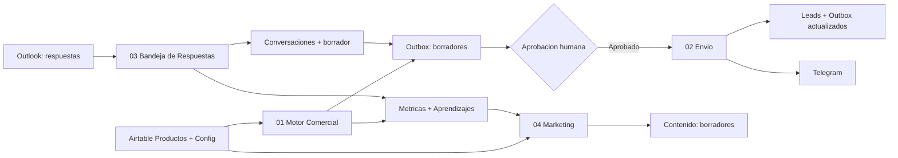

# Sistema de Ventas para Lamparas 3D

Este paquete convierte el escenario prototipo de Make en un sistema comercial con cuatro escenarios, un CRM en Airtable, control humano y aprendizaje. No es un unico flujo que "hace todo": es una mesa de entrada, un motor de prospeccion, una mesa de salida y un motor de contenido.

## 1. Que hace el sistema

- Carga productos con foto, precio, descripcion y argumentos en Airtable.
- Investiga oportunidades reales en la web y califica leads.
- Busca y verifica contactos profesionales con Hunter.
- Redacta correos personalizados y los deja en una mesa de salida para aprobacion.
- Envia solo los correos aprobados, registra el resultado y avisa por Telegram.
- Lee las respuestas, las clasifica, actualiza el lead y prepara una respuesta.
- Genera un plan semanal de contenido organico basado en el catalogo y las metricas.
- Guarda aprendizajes con evidencia para mejorar el proximo ciclo.

## 2. Que NO hace

- No envia correos masivos ni compra listas.
- No publica automaticamente en Instagram, TikTok, Pinterest o LinkedIn.
- No envia WhatsApp ni gestiona pagos.
- No promete ventas: genera oportunidades y prepara el trabajo comercial.
- No reemplaza la revision legal de tu estrategia de contacto en cada pais.

## 3. Arquitectura



## 4. Archivos

- `CONFIGURAR.cmd` y `configurar.ps1`: asistente de doble click que pide el token y el ID de la base, y ejecuta todo.
- `build-blueprints.mjs`: genera los cuatro blueprints desde los prompts.
- `airtable_setup.mjs`: crea la base de Airtable, carga Config y un producto de ejemplo, y genera los archivos `LISTO-*.blueprint.json`.
- `prompts/01-director-comercial.md`: playbook del agente comercial.
- `prompts/03-analista-respuestas.md`: playbook del analista de respuestas.
- `prompts/04-director-marketing.md`: playbook del director de marketing.
- `01-motor-comercial.blueprint.json`: escenario de prospeccion y borradores.
- `02-envio-aprobado.blueprint.json`: escenario de envio de correos aprobados.
- `03-bandeja-respuestas.blueprint.json`: escenario de respuestas de Outlook.
- `04-marketing-contenido.blueprint.json`: escenario de contenido.
- `LISTO-*.blueprint.json`: versiones con la base y las tablas de Airtable ya inyectadas. Importa estos, no los originales.

## 5. Diagnostico del escenario original

El blueprint que enviaste tenia buenas piezas, pero no podia sostener un cuerpo de ventas:

1. No tenia catalogo. El agente no sabia que productos, precios, materiales ni fotos existian.
2. El modulo de Airtable estaba vacio, sin base, tabla, campos ni conexion.
3. El Data Store guardaba solo la clave del dominio, sin empresa, contacto, fecha, producto ni resultado.
4. El agente enviaba correos directamente, sin aprobacion, con riesgo de errores y de quemar el dominio.
5. No leia respuestas. Un cuerpo de ventas que no atiende la bandeja de entrada no vende.
6. No hacia seguimientos ni learning loop.
7. El informe de Telegram era un unico bloque de texto, sin datos estructurados ni estado del pipeline.
8. No tenia limites duros de envio, cumplimiento ni calidad.

Este paquete corrige esos puntos y separa responsabilidades.

## 6. Requisitos

- Make.com con plan que permita escenarios activos y operaciones suficientes.
- Las conexiones que ya tenes en el blueprint original:
  - Make AI Provider: 12349170.
  - Scrappa: 12349301.
  - Hunter: 12349376.
  - Microsoft 365 Email: 12349388.
  - Telegram Bot: 12349438.
- Una conexion de Airtable. No viene incluida en el blueprint: la seleccionas al importar.
- Una cuenta de Airtable con permiso para crear bases.
- Node.js 18 o superior para ejecutar los scripts.
- Un token personal de Airtable (PAT) con permisos `schema.bases:write`, `data.records:read`, `data.records:write` y acceso al workspace.
- El ID del workspace de Airtable. Empieza con `wsp`. Lo encontras en la URL del workspace o en la documentacion de Airtable.

## 7. Puesta en marcha

### Paso 1. Crear la base de Airtable

**Metodo facil (recomendado):**

1. Abri esta carpeta en el Explorador y hace doble click en `CONFIGURAR.cmd` o en el acceso directo **CONFIGURAR SISTEMA DE VENTAS** del Escritorio.
2. Se abre Airtable en el navegador. Crea un token nuevo con los scopes `data.records:read`, `data.records:write`, `schema.bases:read` y `schema.bases:write`. En **Access**, elegi **All current and future bases** o el workspace donde estan tus bases.
3. Copia el token (empieza con `pat`) y pegalo en la ventana negra. No se muestra en pantalla.
4. El asistente busca tus bases automaticamente. Si tenes una sola, la usa. Si tenes varias, te muestra la lista y elegis el numero. Si no tenes ninguna, crea una con **+ Create > Build an app on your own** y volve a ejecutar.
5. El script crea las 8 tablas, carga 21 filas de Config y un producto de ejemplo, y genera los archivos `LISTO-01...`, `LISTO-02...`, etc.

**Metodo manual (si ya tenes el workspace ID):**

```powershell
$env:AIRTABLE_TOKEN="pat..."
$env:AIRTABLE_WORKSPACE_ID="wsp..."
node airtable_setup.mjs
```

El script crea la base "Ventas Lamparas 3D" con las 8 tablas. Si preferis hacerlo a mano, crea las tablas con los campos de la seccion 8. Los nombres deben coincidir exactamente.

### Paso 2. Completar Config

En Airtable, tabla Config, reemplaza los valores "COMPLETAR":

- `marca`: nombre de tu marca.
- `web`: URL de tu web o Instagram.
- `email_remitente`: email desde el que envias.
- `firma`: nombre, cargo, telefono y web.
- `direccion_fisica`: direccion postal para la firma; es obligatoria para CAN-SPAM.
- `propuesta_valor`: que hace unica a tu lampara.
- `modo_envio`: `manual` para aprobar todo; `auto` solo cuando ya confies en el sistema.

Revisa tambien `nichos_prioritarios`, `paises_prioritarios`, `limite_borradores_por_ciclo`, `limite_envios_por_dia` y `no_afirmar`.

### Paso 3. Cargar el primer producto

En Airtable, tabla Productos:

1. Edita el producto de ejemplo o crea uno nuevo.
2. Completa `Producto`, `SKU`, `Estado = Activo`, `Descripcion_corta`, `Descripcion_larga`, `Precio`, `Moneda`, `Material`, `Medidas`, `Colores`, `Lead_time_dias`, `Capacidad_semanal`, `Link_ficha`, `Nicho_ideal`, `Paises_objetivo` y `Argumentos_venta`.
3. Adjunta fotos en `Fotos`. Para los correos, usa `Link_ficha`; las URLs de adjuntos de Airtable caducan.

Nota sobre fotos: el sistema enlaza a la ficha en lugar de adjuntar imagenes pesadas. Eso mejora la entregabilidad y evita que el correo caiga en spam. Adjuntar la foto automaticamente es una fase 2.

El agente solo lee productos con `Estado = Activo`.

### Paso 4. Importar los escenarios en Make

En Make, entra a Scenarios y usa Import Blueprint para subir cada archivo. Importa en este orden:

1. `LISTO-01-motor-comercial.blueprint.json`.
2. `LISTO-02-envio-aprobado.blueprint.json`.
3. `LISTO-03-bandeja-respuestas.blueprint.json`.
4. `LISTO-04-marketing-contenido.blueprint.json`.

En cada importacion:

- Revisa que las conexiones de AI, Scrappa, Hunter, Microsoft y Telegram esten asignadas.
- Selecciona tu conexion de Airtable en cada modulo de Airtable. Make puede pedirla una vez por modulo.
- Verifica que la base y las tablas aparezcan seleccionadas. Si no aparecen, elegi la base "Ventas Lamparas 3D" y la tabla correspondiente.
- Guarda el escenario.

El escenario 03 usa el trigger `microsoft-email:watchEmails`. Si Make lo muestra con error al importar, borra ese modulo y agrega desde el selector "Microsoft 365 Email (Outlook) > Watch Emails", con la carpeta Inbox y criterio Unseen. El resto del flujo queda intacto.

### Paso 5. Configurar horarios

En Make, configura el reloj de cada escenario:

- 01 Motor Comercial: todos los dias a las 08:00, zona America/Argentina/Buenos_Aires.
- 02 Envio Aprobado: cada 6 horas. Procesa como maximo 5 correos por corrida.
- 03 Bandeja de Respuestas: cada 15 minutos.
- 04 Marketing: todos los lunes a las 09:00.

No aumentes la frecuencia del 02 sin ajustar el limite diario y el calentamiento del dominio.

### Paso 6. Prueba controlada

1. Ejecuta 01 con "Run once". Debe leer Config y catalogo, investigar y crear hasta 3 borradores en Outbox. Si Config esta incompleta, debe detenerse y avisar.
2. Abre Outbox. Revisa un borrador. Si esta bien, cambia `Estado` a `Aprobado`.
3. Ejecuta 02 con "Run once". Debe enviar el correo, cambiar `Estado` a `Enviado`, guardar `Enviado_en` y `Message_ID`, y avisar por Telegram.
4. Responde ese correo desde otra casilla. Ejecuta 03 con "Run once". Debe crear una fila en Conversaciones, actualizar el lead y crear un borrador de respuesta en Outbox.
5. Ejecuta 04 con "Run once". Debe crear entre 3 y 6 piezas en Contenido con `Estado = En_revision`.
6. Revisa que Telegram haya recibido los tres informes.

Si algo falla, no actives el escenario hasta resolverlo. La seccion 12 tiene las causas mas comunes.

### Paso 7. Activar

Activa los cuatro escenarios. Durante la primera semana, revisa la mesa de entrada dos veces por dia y aprueba manualmente cada correo.

En cada escenario, activa las notificaciones de error de Make (Scenario settings > Notifications) para recibir un aviso si una corrida falla.

## 8. Modelo de datos de Airtable

### Productos

Producto, SKU, Estado, Descripcion_corta, Descripcion_larga, Precio, Moneda, Material, Medidas, Colores, Lead_time_dias, Capacidad_semanal, Fotos, Link_ficha, Nicho_ideal, Paises_objetivo, Argumentos_venta.

### Leads

Lead, Tipo, Dominio, Web, Pais, Ciudad, Idioma, Nicho, Producto_interes, Fuente_URL, Senal, Score, Estado, Contacto_nombre, Contacto_cargo, Contacto_email, Email_estado, Fecha_alta, Ultimo_contacto, Proximo_paso, Notas.

### Outbox

Asunto, Lead, Para, Nombre_destinatario, Cuerpo_HTML, Idioma, Producto, Paso, Estado, Programado_para, Enviado_en, Message_ID, Respondido, Notas.

### Conversaciones

Asunto, Lead, Contacto, Email, Canal, Direccion, Clasificacion, Sentimiento, Resumen, Mensaje_original, Borrador_respuesta, Estado, Fecha, Message_ID, Notas.

### Contenido

Titulo, Plataforma, Formato, Gancho, Copy, Hashtags, CTA, Producto, Estado, Fecha_publicacion, Metricas, Aprendizaje.

### Config

Clave, Valor.

### Metricas

Fecha, Leads_nuevos, Emails_enviados, Respuestas, Respuestas_positivas, Reuniones, Propuestas, Ventas, Ingresos, Notas.

### Aprendizajes

Hallazgo, Fecha, Fuente, Evidencia, Accion, Agente.

## 9. Vistas recomendadas en Airtable

Crea estas vistas para que la base funcione como dashboard:

- Productos: galeria con `Fotos`, filtrada por `Estado = Activo`.
- Leads: kanban por `Estado`; vista "Para contactar" filtrada por `Score >= 4` y `Estado = Investigado`.
- Outbox: vista "Para aprobar" filtrada por `Estado = En_revision`; vista "Aprobados" filtrada por `Estado = Aprobado`.
- Conversaciones: vista "Mesa de entrada" filtrada por `Estado = Pendiente`.
- Contenido: kanban por `Estado`; vista "Para revisar" filtrada por `En_revision`.
- Metricas: grilla ordenada por fecha descendente.
- Aprendizajes: grilla ordenada por fecha descendente.

Para un dashboard mas visual, crea una Interface de Airtable con:
- Una seccion "Mesa de entrada" con Conversaciones Pendiente y Outbox En_revision.
- Una seccion "Pipeline" con Leads en kanban.
- Una seccion "Contenido" con Contenido en kanban.
- Una seccion "Numeros" con Metricas.

## 10. Operacion diaria

### 10 minutos por la manana

1. Abre Telegram y lee el informe del Motor Comercial.
2. Abre Airtable, vista "Para aprobar". Lee cada borrador.
3. Aprueba, edita o descarta. Si editas, corregi el texto en `Cuerpo_HTML` y cambia `Estado` a `Aprobado`.
4. Abre Conversaciones Pendiente. Revisa las respuestas y los borradores.
5. Aprueba las respuestas que quieras enviar.

### 10 minutos por la tarde

1. Revisa Outbox Enviado y Conversaciones nuevas.
2. Actualiza el estado de los leads que avanzaron.
3. Si un lead pidio baja, verifica que este en OptOut.
4. Revisa que no haya errores en Make.

### Semanal

1. Revisa Metricas y Aprendizajes.
2. Ajusta Config: nichos, paises, propuesta de valor, limites.
3. Revisa el plan de contenido y aprueba las piezas.
4. Revisa la deliverability: rebotes, quejas, respuestas.

## 11. Limites, cumplimiento y deliverability

- El sistema esta disenado para contacto B2B relevante, no para envio masivo.
- Todo correo incluye identificacion y linea de baja.
- Las bajas se respetan de inmediato: el lead pasa a OptOut y no se vuelve a contactar.
- No compres listas ni uses datos privados.
- En la Union Europea, el contacto en frio B2B requiere una evaluacion de interes legitimo, minimizacion de datos y derecho de oposicion. En Estados Unidos, CAN-SPAM exige identificacion, asunto honesto, direccion fisica y opt-out. En Argentina, la Ley 25.326 regula datos personales. Consulta a un abogado antes de escalar.
- Empieza con 5 a 10 correos por dia y subi gradualmente. Un dominio nuevo que envia 50 correos el primer dia se quema.
- Revisa rebotes y quejas. Si un dominio rebota mas del 3% o recibe quejas, detene el envio y limpia la lista.
- No prometas precios, plazos, certificaciones ni envios que no puedas cumplir.

## 12. Problemas comunes

- "Connection required": selecciona la conexion en el modulo. Para Airtable, usa la misma conexion en todos los modulos.
- Error 403 al crear la base: el token no tiene `schema.bases:write` o tu usuario no es creador del workspace. Corregi los permisos y volve a ejecutar el script.
- "Table not found": ejecuta `airtable_setup.mjs` o selecciona la tabla manualmente. Los nombres deben coincidir.
- La base nueva no aparece en Make: reconecta la app Airtable en Make y otorgale acceso a la base "Ventas Lamparas 3D".
- "Field not found": revisa que los nombres de los campos sean exactamente los de la seccion 8. El script los crea.
- "Airtable rate limit": baja `maxRecords`, corre el escenario con menos frecuencia o espera unos minutos.
- Hunter no encuentra email: no inventes un correo. Busca otra persona o descarta el lead.
- El agente no crea borradores: revisa que Config no tenga "COMPLETAR", que haya un producto Activo y que el email este verificado.
- El modelo `large` no aparece o falla: abri el modulo del agente y elegi `medium` o el modelo mas potente disponible en tu conexion de Make AI Provider.
- Telegram no envia: revisa la conexion del bot y el chat ID `5144879357`. Si cambiaste de chat, actualiza el valor en los modulos de Telegram.
- Watch Emails no dispara: revisa la carpeta Inbox, el criterio Unseen y los permisos Mail.Read de la conexion de Microsoft.
- El cuerpo del correo llega vacio en el 03: revisa el mapeo del trigger. Segun la version del modulo, el cuerpo puede estar en `body.content` o en `bodyPreview`; ajusta el campo en el modulo del agente.
- El remitente llega vacio en el 03: el campo puede llamarse `from.address` o `from.emailAddress.address`; elegi el que exista en el panel de mapeo.
- El correo se envio dos veces: revisa si el escenario 02 se ejecuto en paralelo. Dejalo en modo secuencial y no lo corras manualmente mientras esta activo.

## 13. Metricas y plan de 90 dias

### Metricas que importan

- Tasa de rebote: menos de 3%.
- Quejas de spam: menos de 0.1%.
- Tasa de respuesta: 5% a 10% es un buen punto de partida.
- Tasa de respuesta positiva: 2% a 5%.
- Reuniones por cada 100 correos.
- Propuestas por cada 10 reuniones.
- Ventas por producto y por nicho.
- Tiempo desde el primer contacto hasta la venta.

### Semana 1

- Completar Config y un producto real.
- Probar los cuatro escenarios con un lead de prueba.
- Aprobar manualmente cada correo.

### Semanas 2 a 4

- 3 borradores por dia, 5 a 10 envios por dia.
- Dos seguimientos por contacto.
- Revisar respuestas y objeciones.
- Ajustar nichos y paises con evidencia.

### Mes 2

- Agregar 2 o 3 productos.
- Probar dos angulos de asunto por nicho.
- Publicar el contenido aprobado.
- Revisar que plataformas generan consultas reales.

### Mes 3

- Duplicar lo que funciona: nicho, producto, pais y angulo.
- Explorar marketplaces (Etsy u otros) y venta corporativa.
- Evaluar Instagram/TikTok de publicacion automatica, WhatsApp Business y una tienda propia.
- Revisar costos de Make, Hunter, Scrappa y Airtable contra los ingresos.

## 14. Siguientes evoluciones

- Adjuntar una foto del producto al correo desde Airtable (requiere descargar el adjunto y mapearlo en el modulo de Microsoft).
- Respuestas con threading perfecto: hoy el escenario 02 envia la respuesta como correo nuevo con asunto "Re:". Para una fase 2, usar el modulo "Reply to an Email" de Microsoft 365 con el Message_ID original.
- Publicacion automatica en Instagram/TikTok mediante un conector o un webhook.
- WhatsApp Business para seguimiento de leads calientes.
- Etsy/Shopify para catalogo y pedidos.
- Dashboard externo con Metabase o Looker Studio alimentado por Airtable.
- Comandos por Telegram para consultar el estado, aprobar borradores o cargar un producto con foto y precio sin abrir Airtable.
- Agente de propuestas que genere PDFs con precio y ficha tecnica.
- Agente de postventa que pida resenas y detecte oportunidades de recompra.

## 15. Seguridad

- No pongas tokens en los blueprints ni en el repositorio.
- El token de Airtable se usa solo en el script, desde variables de entorno.
- Revisa los permisos de las conexiones de Make.
- No compartas la base con personas que no deban ver datos de clientes.
- Rota el token de Airtable si se filtra.
- Revisa periodicamente los leads OptOut y las bajas.

## 16. Criterio de exito

El sistema esta funcionando cuando:
- Cada dia hay 3 borradores nuevos con evidencia y contacto verificado.
- Cada correo enviado tiene estado, fecha y Message_ID.
- Cada respuesta aparece en Conversaciones y actualiza el lead.
- Cada semana hay un plan de contenido con piezas listas para aprobar.
- Cada semana hay al menos un aprendizaje con evidencia.
- El dueno puede ver el estado completo en Airtable y Telegram en menos de 10 minutos.

Si alguna de estas condiciones no se cumple, el problema no es el agente: es un dato, una conexion o un limite que hay que corregir.
